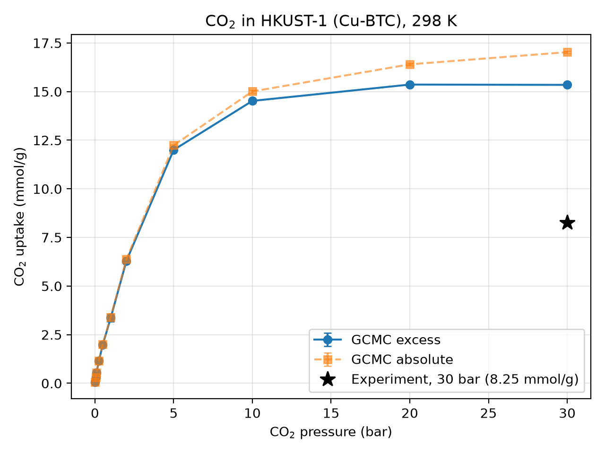

# CO2 adsorption isotherm in Cu-BTC (HKUST-1) with RASPA3

Grand canonical Monte Carlo (GCMC) isotherm for CO2 in Cu-BTC at 298 K, from 0.01 to 30 bar,
computed with [RASPA3](https://github.com/iRASPA/RASPA3) 3.0.29.



## Results

Excess and absolute uptake in mmol/g (± is RASPA3's block-average error). The full table is in
[isotherm.csv](isotherm.csv).

| P (bar) | Fugacity coeff. | Excess (mmol/g) | Absolute (mmol/g) |
|--------:|----------------:|----------------:|------------------:|
| 0.01 | 1.000 | 0.063 ± 0.004 | 0.063 |
| 0.05 | 1.000 | 0.298 ± 0.009 | 0.300 |
| 0.1  | 0.999 | 0.544 ± 0.036 | 0.548 |
| 0.25 | 0.999 | 1.143 ± 0.057 | 1.155 |
| 0.5  | 0.997 | 1.990 ± 0.038 | 2.013 |
| 1    | 0.995 | 3.355 ± 0.181 | 3.401 |
| 2    | 0.989 | 6.292 ± 0.102 | 6.385 |
| 5    | 0.973 | 11.999 ± 0.038 | 12.235 |
| 10   | 0.946 | 14.520 ± 0.078 | 15.007 |
| 20   | 0.893 | 15.361 ± 0.075 | 16.400 |
| 30   | 0.842 | 15.345 ± 0.062 | 17.028 |

The excess uptake levels off near 15.3 mmol/g above about 20 bar. That is well above the
experimental value plotted for comparison (8.25 mmol/g at 30 bar). This is expected for a
generic force field on a perfect, fully activated crystal with no Cu–CO2 open-metal-site
correction. The numbers should be read as a demonstration of the workflow, not as a
validated prediction.

## Model and settings

The inputs come from RASPA3's example `examples/basic/11_mc_adsorption_of_co2_in_cu_btc`
(tag v3.0.29). The changes made by `run_isotherm.py` are:

- Temperature 298 K, with the eleven pressures listed above
- 5,000 initialization cycles followed by 20,000 production cycles per point
- The fixed `FugacityCoefficient` is removed, so RASPA3 computes it from the Peng–Robinson
  equation of state (critical constants in `CO2.json`). The coefficient is about 1 at low
  pressure and 0.84 at 30 bar.

The rest is unchanged from the example. That covers a rigid Cu-BTC framework (1×1×1 unit cell,
a = 26.343 Å), a rigid three-site CO2 model, Lennard-Jones interactions with Lorentz–Berthelot
mixing and a 12 Å shifted cutoff, and Ewald summation for the charges. The MC moves are
translation, rotation, reinsertion, swap (insertion/deletion) and Widom insertion.

## Files

| File | Purpose |
|------|---------|
| `run_isotherm.py` | Copies the RASPA3 example into one `P_<pressure>Pa/` folder per pressure, edits `simulation.json`, and starts all points in parallel |
| `monitor.py` | Prints progress and an ETA for running points (`python monitor.py --watch 60`) |
| `collect_isotherm.py` | Reads the RASPA3 output files and writes `isotherm.csv` and `isotherm.png` |
| `isotherm.csv`, `isotherm.png` | Results |

The raw `P_*` run folders are not included in the repository (see `.gitignore`).

## Reproducing

You need RASPA3 3.0.29, Python and matplotlib. RASPA3 is available from conda-forge:

```bash
conda create -n ads -c conda-forge raspa3=3.0.29 python matplotlib
```

The scripts expect this repository at `~/projects/cubtc_isotherm` and the RASPA3 source
(only its example inputs are used) at `~/projects/raspa3-src`:

```bash
cd ~/projects
curl -L https://github.com/iRASPA/RASPA3/archive/refs/tags/v3.0.29.tar.gz | tar xz
mv RASPA3-3.0.29 raspa3-src

cd cubtc_isotherm
conda run -n ads python run_isotherm.py      # starts all 11 points at once
conda run -n ads python monitor.py --watch 60
conda run -n ads python collect_isotherm.py
```

`run_isotherm.py` starts all eleven points at once, one process each. On the 20-core machine
used here the low-pressure points finished in 2–4 minutes and the 10–30 bar points in about
28 minutes. If you have fewer cores, run the points in smaller batches.
